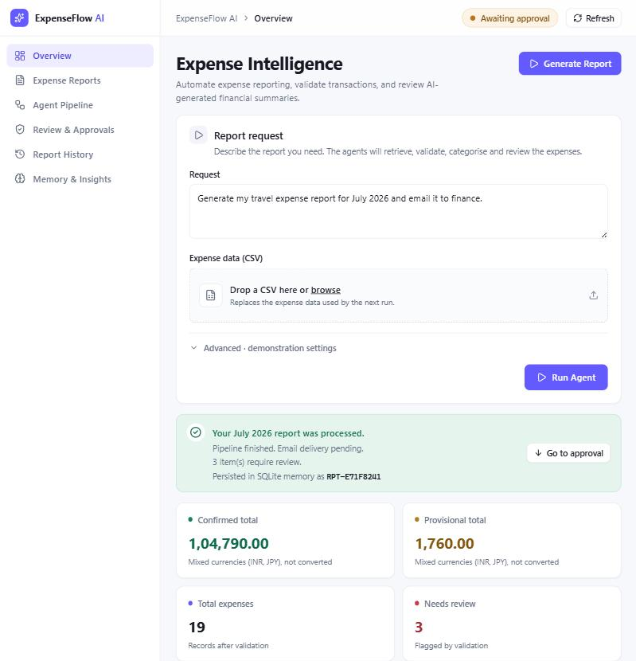
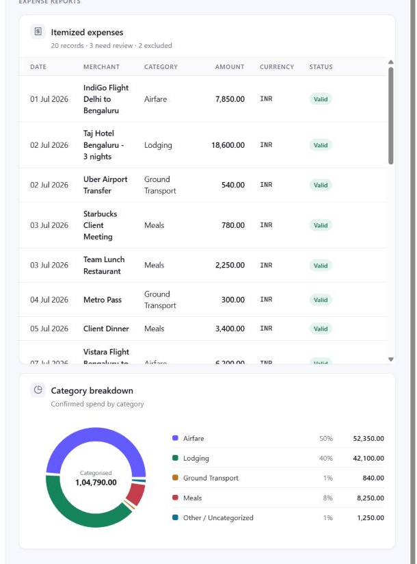
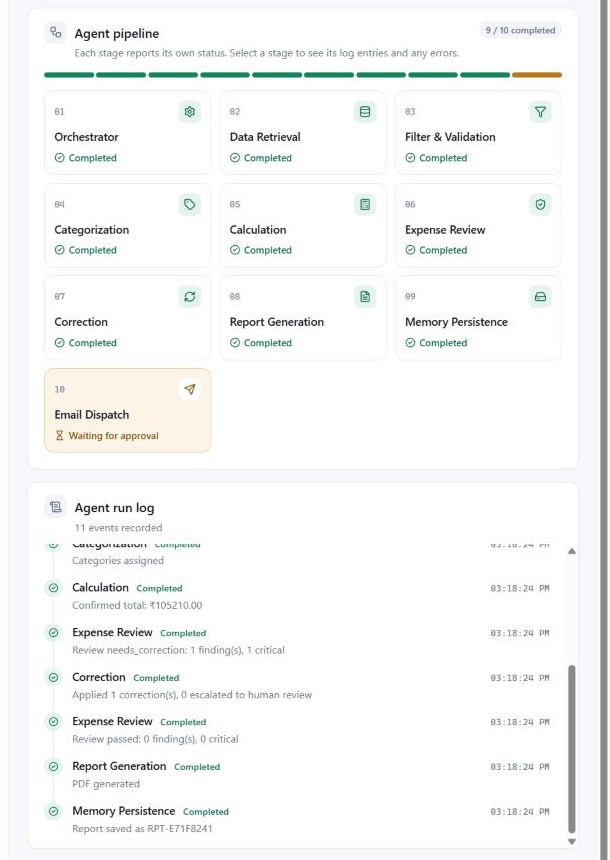
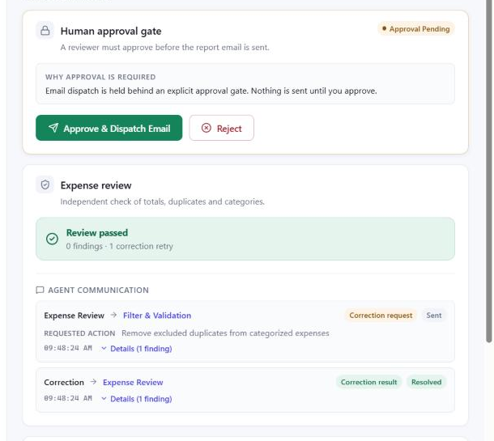
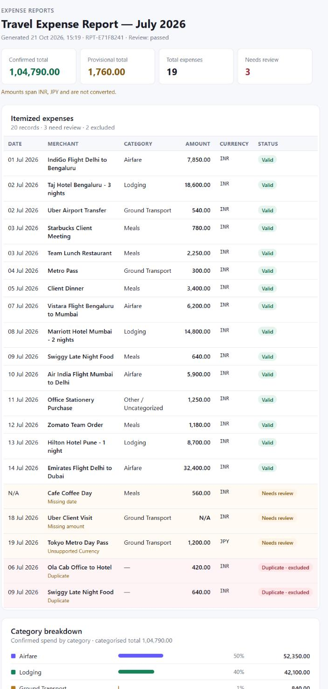
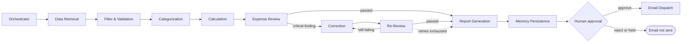

# ExpenseFlow AI — Expense Report Agent

**A multi-agent system that turns a raw expense spreadsheet into a validated, reviewed PDF report and a ready-to-send email, with a human approving before anything leaves the building.**




---

## Table of contents

- [Overview](#overview)
- [Features](#features)
- [Screenshots](#screenshots)
- [How it works](#how-it-works)
- [Unit III & IV extensions](#unit-iii--iv-extensions)
- [Tech stack](#tech-stack)
- [Project structure](#project-structure)
- [Getting started](#getting-started)
- [Configuration](#configuration)
- [Sample datasets](#sample-datasets)
- [Using the app](#using-the-app)
- [API reference](#api-reference)
- [Testing](#testing)
- [Known limitations](#known-limitations)
- [Authors](#authors)

---

## Overview

Preparing a travel expense report by hand is slow and error-prone: records are duplicated, dates and amounts go missing, categories are inconsistent, totals are miscalculated, and someone still has to email the result.

**ExpenseFlow AI** automates that whole lifecycle. You upload a CSV and describe the report you want; a pipeline of specialist agents retrieves, validates, categorises, calculates, independently reviews, corrects, documents and (after approval) emails the report.

Two design principles run through the project:

- **Never trust a single agent's arithmetic.** Totals are computed in deterministic Python, then re-computed by a separate Review agent. The LLM is deliberately kept away from financial maths.
- **Never send irreversibly without a human.** Email dispatch is gated behind an explicit approve/reject step.

## Features

- **Autonomous 10-stage agent pipeline** built on LangGraph, with live status for every stage.
- **Data validation** — flags missing dates and amounts, excludes duplicates, flags unsupported currencies, filters to the requested month.
- **Hybrid categorisation** — deterministic keyword rules first, LLM (Groq) only when unsure.
- **Confirmed vs. provisional totals** — flagged items never silently change the confirmed total.
- **Independent review and self-correction** — a Review agent audits the calculations and sends structured correction requests to a Correction agent, with a bounded retry loop and human escalation.
- **Human approval gate** — approve & dispatch, or reject.
- **Persistent memory** — every report is saved to SQLite; browse Report History, recall prior reports, and **export the history as a PDF**.
- **Professional outputs** — PDF report and an HTML email that mirrors the dashboard (itemised table, category breakdown, items needing review).
- **Modern dashboard** — responsive React UI with a collapsible sidebar, pipeline visualisation with per-stage details, run-log timeline, agent-communication view, and CSV drag-and-drop upload.

## Screenshots

| | |
|---|---|
|  |  |
| **Itemised expenses & category breakdown** — flagged and excluded records are highlighted | **Agent pipeline & run log** — live per-stage status |
|  |  |
| **Review, agent communication & approval gate** | **Generated HTML email** |

## How it works

All agents read from and write to one shared state object, the **blackboard** (`ExpenseReportState`). LangGraph connects them and routes between them with conditional edges.



| # | Stage | What it does | LLM? |
|---|---|---|---|
| 1 | **Orchestrator** | Reads the month from the request (falls back to "last month"), builds the plan, recalls prior reports from memory | No |
| 2 | **Data Retrieval** | Loads and parses `backend/data/expenses.csv` | No |
| 3 | **Filter & Validation** | Filters to the period; flags missing date/amount and unsupported currency; excludes duplicates | No |
| 4 | **Categorization** | Airfare / Lodging / Meals / Ground Transport via keyword rules; LLM fallback for unknown merchants | Fallback only |
| 5 | **Calculation** | Exact decimal totals: confirmed, provisional, per-category | No |
| 6 | **Expense Review** | Independently re-checks totals, duplicates, missing fields, category subtotals and report consistency | No |
| 7 | **Correction** | Fixes critical findings and recalculates; replies to the Review agent | No |
| 8 | **Report Generation** | Builds the PDF report (ReportLab) | No |
| 9 | **Memory Persistence** | Saves the report summary to SQLite | No |
| 10 | **Email Dispatch** | Sends the report email — only after human approval | No |

A run that finds nothing to correct simply skips stage 7 ("Not needed" in the UI). Stage 10 stays at **Waiting for approval** until a reviewer acts.

### Review and correction loop

The Review agent recomputes every figure and raises findings with a severity. **Critical** findings (total mismatch, duplicate included in totals, inconsistent report) set the review to *needs correction* and send a structured `correction_request` message to the responsible agent. The Correction agent applies a deterministic fix, replies with a `correction_result`, and the review runs again. The loop is capped at **3 retries**, after which the report is held for human review.

### Human approval gate

After the report is saved, the pipeline stops. Nothing is emailed until a reviewer clicks **Approve & Dispatch Email** (or **Reject**) in the dashboard, which calls a separate API endpoint.

## Unit III & IV extensions

This project was extended for the *Agentic AI* (23CSE4018) mini-project jury.

| Unit | Concept | Implementation |
|---|---|---|
| **III** — Memory, Tools & Environment | Short- and long-term memory | **Short-term:** the shared blackboard state, alive for one run. **Long-term:** report summaries persisted in SQLite and recalled by the Orchestrator; browsable in *Report History* and *Memory & Insights*. |
| **IV** — Multi-Agent Systems & Collaboration | Role-based agents, structured communication, human-in-the-loop | Specialist agents with bounded roles; typed `AgentMessage` objects between Review and Correction; bounded retry loop with escalation; approval gate before dispatch. |

## Tech stack

| Layer | Technology |
|---|---|
| Agent orchestration | LangGraph |
| Backend API | FastAPI, Uvicorn, Pydantic |
| Persistence | SQLite via SQLAlchemy |
| LLM (optional) | Groq-hosted model through LangChain |
| PDF / email | ReportLab, SMTP (simulated in development mode) |
| Frontend | React 19, Vite, Recharts, lucide-react, Axios, jsPDF (history export) |
| Testing | pytest |

## Project structure

```
expense-report-agent/
├── backend/
│   ├── app/
│   │   ├── agents/        # one module per agent (orchestrator, review, correction, ...)
│   │   ├── graph/         # LangGraph workflow and routing (expense_graph.py)
│   │   ├── models/        # SQLAlchemy models (report history, messages, preferences)
│   │   ├── services/      # memory, PDF, email, CSV parsing, LLM, email template
│   │   ├── state/         # blackboard (ExpenseReportState) and message types
│   │   └── main.py        # FastAPI app and endpoints
│   ├── data/              # expenses.csv (active dataset) and sample datasets
│   ├── tests/             # pytest suites
│   └── requirements.txt
├── frontend/
│   └── src/
│       ├── components/    # dashboard sections (pipeline, table, review, history, ...)
│       ├── styles/        # design tokens and feature styles (index.css + features.css)
│       ├── utils/         # formatting helpers, history PDF export
│       └── services/api.js
├── docs/screenshots/
├── jury/                  # jury / viva material
└── render.yaml            # Render deployment blueprint
```

## Getting started

### Prerequisites

- Python 3.12+
- Node.js 18+

### 1. Backend

```bash
cd backend
python -m venv .venv

# Windows
.venv\Scripts\activate
# macOS / Linux
source .venv/bin/activate

pip install -r requirements.txt
cp .env.example .env        # then edit values (see Configuration)
uvicorn app.main:app --reload
```

The API is served at `http://localhost:8000` (interactive docs at `/docs`).

### 2. Frontend

```bash
cd frontend
npm install
npm run dev
```

Open `http://localhost:5173`. The frontend talks to `http://localhost:8000/api` by default; set `VITE_API_URL` to point elsewhere.

## Configuration

Copy `backend/.env.example` to `backend/.env`:

| Variable | Purpose |
|---|---|
| `DEVELOPMENT_MODE` | `true` (default): emails are **simulated** and saved to `backend/reports/simulated_emails/` as `.txt` and `.html`. Set `false` to send real email over SMTP. |
| `FINANCE_EMAIL` | Recipient of the report email. |
| `SMTP_HOST`, `SMTP_PORT`, `SMTP_USERNAME`, `SMTP_PASSWORD`, `SMTP_FROM` | SMTP settings (used only when `DEVELOPMENT_MODE=false`; sends retry up to 3 times with backoff). |
| `GROQ_API_KEY` | Optional. Enables the LLM fallback in Categorization. Without it, unrecognised merchants are labelled *Other / Uncategorized* and the whole system still runs. |

Frontend: `VITE_API_URL` — base URL of the backend API.

> Never commit `backend/.env`. It is listed in `.gitignore`.

## Sample datasets

The agent reads **one file**, `backend/data/expenses.csv`. The **Upload CSV** control in the dashboard overwrites it. Ready-made datasets live alongside it — upload one to try the system:

| File | Rows | Purpose |
|---|---|---|
| `sample_all_steps.csv` | 21 | Exercises **every stage, including Correction** (a duplicate that reuses an expense ID triggers the review/correction loop without any demo switch). |
| `sample_full_test.csv` | 25 | Every validation case: valid rows, duplicates, missing date/amount, mixed and unsupported currencies, an out-of-period row. The review passes, so Correction is "Not needed". |
| `sample_large_july_2026.csv` | 392 | Large realistic month for volume testing, with all edge cases. |
| `expenses_july_2026.csv` | 10 | Small baseline dataset. |

CSV columns: `date` (`YYYY-MM-DD`), `expense_id`, `description`, `amount`, `currency`.

## Using the app

1. **Upload** a CSV (or use the current one).
2. Type a request. The agent reads **only the month and year** from it:
   ```
   Generate my travel expense report for July 2026 and email it to finance.
   ```
   Without a recognisable "Month YYYY", it falls back to "last month" (July 2026 — the system date is fixed at 31 Aug 2026).
3. Click **Run Agent** and watch the pipeline; click any stage for its log entries.
4. Review the metrics, itemised expenses, category breakdown and review findings.
5. **Approve & Dispatch Email** (or **Reject**).
6. Open **Report History** to browse saved reports and **Export PDF**.

**Demo the Unit IV loop:** open *Advanced · demonstration settings* and tick *Inject calculation discrepancy*. The Review agent will catch the deliberate error, send a correction request, and the Correction agent will fix it (see *Agent communication*).

## API reference

Base URL: `http://localhost:8000/api`

| Method | Endpoint | Description |
|---|---|---|
| `GET` | `/health` | Health check |
| `POST` | `/run` | Start a run (`request_text`, `user_id`, `inject_discrepancy`) |
| `GET` | `/run/{run_id}` | Live state: agent statuses, totals, expenses, flags, review result, messages |
| `GET` | `/run/{run_id}/logs` | Run log entries |
| `GET` | `/run/{run_id}/messages` | Persisted inter-agent messages |
| `POST` | `/run/{run_id}/approve` | Approve and dispatch the email |
| `POST` | `/run/{run_id}/reject` | Reject; email is not sent |
| `POST` | `/expenses/import` | Upload a CSV (replaces `data/expenses.csv`) |
| `GET` | `/reports/history` | List saved reports |
| `GET` | `/reports/{report_id}` | One saved report |
| `GET` / `POST` | `/preferences/{user_id}` | Read / set user preferences |

## Testing

```bash
cd backend
# Windows PowerShell:  $env:PYTHONPATH="."
# macOS / Linux:       export PYTHONPATH=.
pytest tests/
```

The suite (33 tests) covers the core pipeline, regression behaviour, persistent memory (Unit III), multi-agent collaboration, retry limits, escalation and approval handling (Unit IV), and the API extensions. Some tests run the full graph and may add records to the default local SQLite database, so run them against a development setup.

Frontend checks:

```bash
cd frontend
npm run lint
npm run build
```

## Known limitations

Documented honestly so nobody is surprised:

- **Fixed workflow.** The pipeline is a predefined LangGraph graph; the Orchestrator's plan is a fixed list, not dynamic LLM planning.
- **Minimal LLM use.** Only the categorisation fallback calls a model. Arithmetic and review are deliberately LLM-free.
- **Run state is in memory.** Live run state (and therefore approve/reject) lives in the server process; restarting the backend loses in-flight runs. Saved reports persist in SQLite.
- **Agent messages are not persisted.** They are returned with the live run and shown in the UI, but are not written to the database, so `/run/{id}/messages` is empty for live runs.
- **Recall is informational.** Prior reports are recalled and shown, but do not change the agent's decisions; stored user preferences are not yet used by the pipeline.
- **No currency conversion.** Amounts in different currencies are summed as-is; the UI and email flag mixed-currency runs.
- **Duplicate check matches by expense ID.** If a copied row reuses the original's ID, the Correction agent removes both records.
- **PDF file name.** The generated report is named after the user ID, so each run overwrites the previous PDF.

## Authors

Rakshit Girase and Suketu Mishra — T.Y. B.Tech (AIA), *Agentic AI* (23CSE4018).
